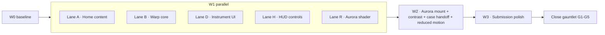

# Sprint: Warp (portfolio elevation toward Awwwards SOTM / FWA)

## Goal
Refined, layered site where the craft lives in the transitions: every route change is a short hyperspeed warp
along the same Z axis the home's 3D journey (`PrintRun`) already floats on. Forward = fly in, back = fly out.
Riso / 8-bit / overprint show up only as restrained artifacts of speed (plate-offset streaks, a dither ramp at
peak velocity), never as a flash. At rest: quiet, hard-edged instrument UI, work first, no face.

## Concept: Cosmos HUD (owner, 2026-11-07)
The site is one space; every route is a destination with coordinates. Moving between routes is a 3D,
HUD-driven jump across the cosmos; the existing instruments become the ship's controls, and the fountain wash
becomes an aurora hanging in that space.
- **Signature moments, all already half-built:** the Home Z journey (`PrintRun`) is cruising; the works dial
  (`works/page.tsx`) is the targeting dial; the mobile hold-to-navigate radial (`MobileNavbar.tsx:100,261`) is
  the jump drive (hold = charge, release = jump); the contacts flip card (`contacts/page.tsx:303-374`) is the
  docking arrival at the end of the journey.
- **Warp follows a heading:** each destination has `{x,y,z}`; a jump's streaks bend along the vector from the
  current destination to the next, so Works→Contacts feels different from Contacts→Home. Back = reverse vector.
- **Aurora:** the `Fountain` shader gets an aurora mode: slow vertical curtains in the existing ink palette,
  kept as the far backdrop behind streaks and pages; it replaces the existing page-plate wash (one WebGL context), 24fps, paused offscreen.
- **HUD, not a game skin:** hairline frame, notched rails, sharp buttons, coordinate readout of the current
  destination. Nothing on screen without a function.

## Durability rule (owner, 2026-11-07): the metaphor is felt, never stated
The cosmos / HUD / riso ideas drive motion and structure only. What is on screen stays sharp, minimal,
utilitarian, so it doesn't date in a year.
- No game or space vocabulary anywhere in UI copy or labels ("jump", "dock", "warp", "sector", coordinates).
  Those words exist only as internal code names.
- Readouts are plain information: index `02 / 06`, route name, year. No faux telemetry, no X/Y/Z numbers.
- No retro skins: no pixel fonts, scanlines, CRT curvature, sci-fi glyphs, glow. Type stays the two families.
- Riso / 8-bit appear only as sub-second residue during motion (≤3px plate offset, dither ≤0.18 opacity);
  at rest the page shows none of it.
- Aurora is low-contrast colour light in the far background, slow; it never carries meaning and is never the subject.
- Test for every element: would it still look right on a 2030 product site? If not, cut it.

## Reference: Shopify Editions Winter '26 (studied 2026-11-07)
- Persistent hairline frame (golden-ratio grid lines, notched corners) sits at its own depth and survives the
  section change; content moves underneath it. → our `WarpFrame` layer.
- Changes are cross-fades of colour fields plus layers moving at different rates, not cuts. → each warp has
  3 depth bands (frame, streak field, page) with their own timing.
- Nothing whites out; ground colour shifts over ~600ms. → no opacity-to-white, the paper/ink ground is
  continuous through the warp.
Technique only; no assets or copy taken.

## Fixed facts (from the code)
| Fact | Where | Consequence |
|---|---|---|
| Home is a CSS-3D Z journey: sheets 1400px apart, spring camera (k100 c28 m0.6) | `src/components/riso/PrintRun.tsx:13-14` | Warp reuses DEPTH and the spring for continuity |
| Route swap wraps `{children}` in React `<ViewTransition default="sheet">` | `src/app/layout.tsx:108`, `next.config.ts:24` | Warp is CSS on `::view-transition-*(.sheet)`; no router fork |
| Current VT is a 160ms opacity fade | `src/styles/riso.css:238-244` | Replaced by the 3D warp keyframes |
| Exit lift: blocks rise 0.9rem + blur, 22ms stagger, then `router.push` | `src/components/ExitChoreographer.tsx:13-16,62-69` | Becomes depth stagger (blocks pushed toward camera), direction-aware |
| Back/forward can't be intercepted | `ExitChoreographer.tsx:6` | Direction comes from a `popstate` flag → `html[data-warp=back]` |
| Star streak canvas exists, used only on /contacts | `src/components/StarField.tsx`, `src/app/contacts/page.tsx:8` | Port its projection math into a global `WarpField` |
| Loader overlays the first load | `src/app/layout.tsx:102`, `LoadingScreen.tsx` | Removed; first paint is a warp arrival |
| Home hero = blurred name + standing portrait; eye crop in manifesto; testimonials sheet | `src/app/page.tsx:35-73` | Face and testimonials go; reel becomes sheet 1 |
| Testimonials only used by home | `page.tsx`, `ProofDrift.tsx`, `data/testimonials.ts` | Delete all three uses |
| Case pages already hand off to next project | `ProjectPageClient.tsx:419,651-661` | Next link fires a forward warp, no new UI |
| Scripts: `lint`, `test` (vitest), `test:e2e` (playwright), `build` | `package.json` | Verify = `npx tsc --noEmit && npm run lint && npm run test` |

## Decisions
| Decision | Reason |
|---|---|
| No signature toy; the warp transition is the signature | Owner: craft in transitions, refined, no flashbang |
| Warp total 900ms (exit 380, travel 220, arrival 300 overlapping), ease `[0.23,1,0.32,1]` arrival, `[0.7,0,0.84,0]` exit | Considered, not snappy; matches existing exit ease |
| Peak artifacts capped: streak plate offset ≤ 3px, dither ramp opacity ≤ 0.18, only during travel | Riso/8-bit as residue of speed, never a flash |
| Ground colour never changes during a warp (no white/black frame) | No hard flashes (AGENTS §0) |
| Back nav = mirrored warp (layers recede, streaks reverse) | Owner: forward/backward warp |
| Reduced motion: 200ms cross-fade, frame layer static, no streaks | AGENTS §6 |
| Home order: Reel (with name strip) → 3 featured works (one per sheet) → manifesto + ledger + clients → View Works | Work first, uncluttered: one thing per sheet |
| Featured = `herond-browser`, `defrasoft`, `z-cung-viet` | First three real case studies in `projects.ts` order |
| Testimonials cut entirely | Owner answer |
| Portrait removed from home (both crops); asset file stays (used elsewhere? checked in A1) | Owner answer |
| No custom cursor this sprint | Not asked; risk to focus states |
| Instrument UI = WarpFrame hairlines + notched index rail + sharp nav buttons, all tokens | Owner aesthetic: dials, notches, sharp buttons |

Out of scope: new case content/copy (no invented copy), new 3D models, sound, cursor, CMS.

## Folded from plan review (plan-review.md)
- VT 3D via `transform: perspective(1400px) translateZ()` in keyframes (perspective on `::view-transition` doesn't reach the images).
- Z travel capped at 120px; forward exits are carried by ExitChoreographer, old-snapshot warp only on Back.
- Direction from a `history.state` index (popstate fires for Back and Forward); `lastPath` kept in warp.ts; `data-warp` cleared after.
- Aurora replaces the existing `page-plate` Fountain (no second WebGL context). Streaks draw nothing at rest; aurora has no dither; grain and plate misregister show only during `html[data-warp]`.
- StarField deleted (contacts used it; WarpField replaces it). LoadingScreen deleted.
- Home JSX rebuilt in one task from an inlined skeleton; reduced motion lives in each task, not a separate one.
- Back/Forward behaviour checked by hand in the browser (V1): React may skip the VT on a synchronous popstate flush. UNVERIFIED until V1.

## Contracts
- `src/lib/warp.ts` (new): `export type WarpDir = "fwd" | "back"`; `export function setWarp(dir: WarpDir): void`
  (sets `document.documentElement.dataset.warp = dir` and dispatches `window` event `"warp"` with `detail: { dir }`);
  `export const WARP = { exit: 380, travel: 220, arrive: 300, depth: 1400 }`;
  `export const DESTS: Record<string, { x: number; y: number; z: number; label: string }>` keyed by the first
  path segment (`""`, `works`, `takes`, `play`, `freebies`, `contacts`);
  `export function heading(from: string, to: string): { x: number; y: number }` (unit 2D screen heading of the
  3D vector; `{0,0}` for same destination). `setWarp` detail becomes `{ dir, heading }`.
- `WarpField` listens to `"warp"` and runs one velocity pulse (0 → peak → 0 over `exit+travel+arrive`), streak
  vanishing point offset by `heading * 0.25 * viewport`.
- `Fountain` gains prop `mode?: "wash" | "aurora"` (default `"wash"`, unchanged output); `aurora` sets uniform `uMode = 1`.
- `MobileNavbar` hold: charge ring progress 0→1 over 450ms while held; release on target ≥ 1 → `setWarp("fwd")` then navigate; release early cancels.
- CSS reads `html[data-warp="fwd"|"back"]` inside `::view-transition-*(.sheet)` rules.
- Tokens added to `src/lib/designSystem.ts` (`motion.warp`) and mirrored as CSS vars `--warp-*` in `src/styles/riso.css`.

## Waves

## Task table
| ID | Wave | Task | Model/effort | Budget |
|---|---|---|---|---|
| W0.1 | 0 | Capture baseline Lighthouse mobile + console per route | haiku/low | 20 |
| B1 | 0 | Create warp.ts: WARP, DESTS, heading, history-index direction, setWarp/clearWarp | haiku/medium | 30 |
| A1 | 1 | Rebuild home JSX to the target skeleton (reel first, 3 featured, manifesto, no face, no testimonials) | haiku/medium | 30 |
| A2 | 1 | Style hud-strip and featured sheets on the 12-col grid | manifesto-eye\ | \.drift" src/app/home.css` |
| B2 | 1 | Direction tracking in ExitChoreographer | dirFromPop\ | clearWarp" src/components/ExitChoreographer.tsx` |
| B3 | 1 | Exit stagger uses scale+opacity, direction-aware | haiku/medium | 20 |
| B4 | 1 | WarpField canvas: streaks only while moving (opus: motion feel) | opus (lead)/low | 30 |
| B5 | 1 | 3D VT keyframes with transform-perspective, Z capped at 120px (opus: motion feel) | opus (lead)/low | 30 |
| B6 | 1 | Mount WarpField, remove LoadingScreen, aurora on page-plate, grain only in motion | haiku/medium | 25 |
| D1 | 1 | Persistent WarpFrame hairline layer with route index readout | haiku/medium | 30 |
| D2 | 1 | Notched index rail driven by PrintRun onIndex | haiku/medium | 30 |
| K1 | 1 | Keyboard flight: W/S sheets, A/D routes, Space opens current | haiku/medium | 30 |
| D3 | 1 | Sharp nav keys on new hudKey tokens | haiku/medium | 25 |
| H1 | 1 | Mobile hold charges before navigating | haiku/medium | 30 |
| H2 | 1 | Works dial ticks every 15° with plain index readout | haiku/medium | 30 |
| H3 | 1 | Contacts card arrives from depth; drop StarField there | haiku/medium | 25 |
| R1 | 1 | Fountain aurora mode, no dither (opus: shader taste) | opus (lead)/low | 30 |
| E1 | 2 | Fix contrast of failing token pairs | haiku/medium | 25 |
| E2 | 2 | Remove at-rest misregister from Plates | haiku/low | 15 |
| P1 | 3 | Add OG image | haiku/low | 20 |
| P3 | 3 | 375/768/1440 layout pass | haiku/medium | 30 |
| P2 | 3 | Console clean, all routes (after P3) | haiku/medium | 20 |
| P4 | 3 | Lighthouse mobile vs budget | opus (lead)/low | 30 |
| V1 | 3 | Manual Back/Forward warp check in browser | haiku/low | 15 |
| G1 | 4 | Close gauntlet loop 1 (all lenses) | opus (lead)/low | 30 |
| G2 | 4 | Close gauntlet loop 2 | opus (lead)/low | 30 |
| G3 | 4 | Close gauntlet loop 3 | opus (lead)/low | 30 |
| G4 | 4 | Close gauntlet loop 4 | opus (lead)/low | 30 |
| G5 | 4 | Close gauntlet loop 5 | opus (lead)/low | 30 |

## Owner dependencies
None. All assets exist in `public/media` and `public/works`. No paid APIs, logins or hardware.

## Unverifiable here
Safari view-transition rendering (no macOS): marked UNVERIFIED; fallback is the existing cross-document-free
fade because Safari < 18 lacks VT and 18+ is untested.
